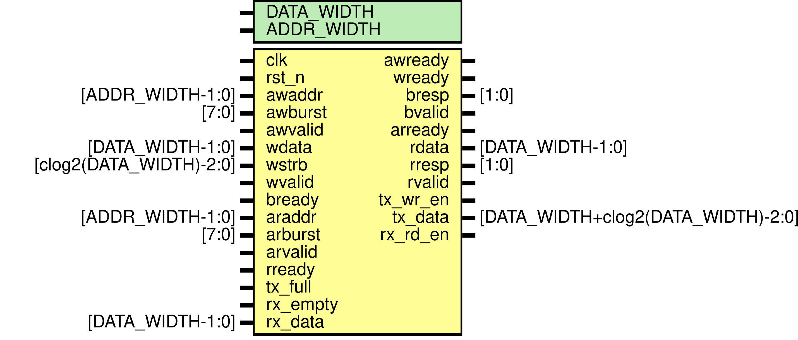
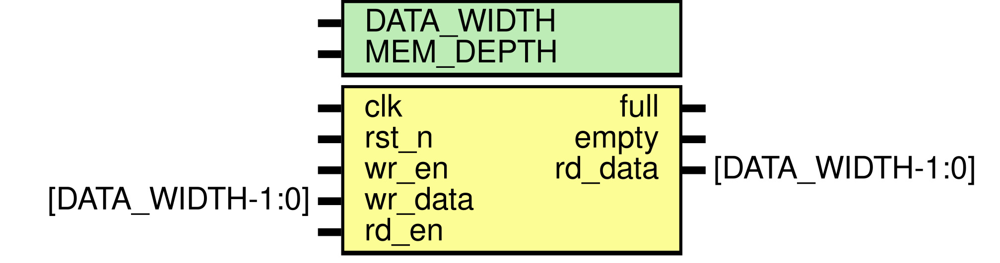
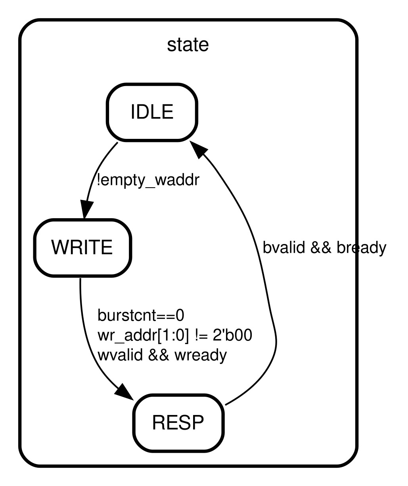
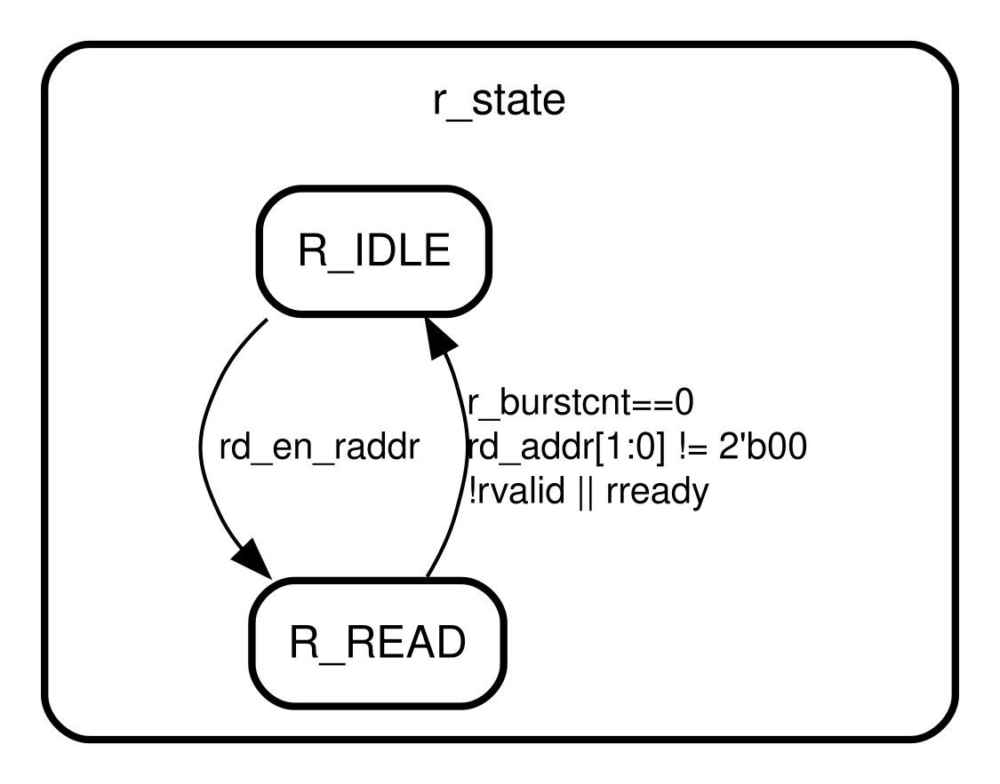

# AXI4 Full Slave with Control, Status, and FIFO Interface

This repository implements a custom AXI4 Full-style slave peripheral in Verilog. It provides:

- a control register for configuration/control
- a status register for queue and state reporting
- a transmit (TX) FIFO interface
- a receive (RX) FIFO interface
- asynchronous FIFO-based clock-domain crossing for peripheral communication

The design is intended for embedded and FPGA-style peripheral interfacing where a host processor or master device interacts with a custom logic block over an AXI-like interface.

## Repository Structure

```text
axi4-slave/
├── README.md
├── rtl/
│   ├── async_fifo.v
│   ├── slave.v
│   ├── sync_fifo.v
│   └── top.v
├── sim/
│   ├── async_fifo.vcd
│   ├── sync_fifo.vcd
│   ├── tb_slave.vcd
│   └── tb_top.vcd
└── tb/
    (testbench files are present in the repository but are not documented here)
```

## RTL Overview

### 1. `rtl/top.v`
This is the top-level integration module.

It connects:
- the AXI-like slave logic
- the transmit asynchronous FIFO
- the receive asynchronous FIFO

The module exposes the main AXI write/read interface and the external FIFO signals used to transfer data in and out of the peripheral domain.

### 2. `rtl/slave.v`
This is the main functional block of the design.



It contains:
- write-channel state machine
- read-channel state machine
- register access logic
- status register generation
- control register storage
- address decode logic
- TX FIFO write handling
- RX FIFO read handling

The slave supports a simplified AXI-style transaction flow and maps memory accesses to internal registers and FIFO operations.

### 3. `rtl/sync_fifo.v`
This is a single-clock synchronous FIFO used internally to store queued address metadata related to burst accesses.



It is used for:
- write address buffering
- read address buffering

The FIFO uses standard pointer-based full/empty detection for a single clock domain.

### 4. `rtl/async_fifo.v`
This is a dual-clock asynchronous FIFO used to bridge between different clock domains.

It contains:
- memory storage
- read and write pointer handlers
- gray-code pointer synchronization
- empty/full logic for the asynchronous domain crossing

This FIFO is used to transfer data safely between the main AXI domain and external peripheral or system clocks.

## Functional Behavior

The slave behaves like a custom peripheral rather than a generic memory-mapped block.

### Control and Status

The design maintains two key internal registers:

- `ctrl` — writable control register
- `status` — read-only status register

The status register is generated as:

- `status[0] = 0`
- `status[1] = !rx_empty`
- `status[2] = tx_full`
- `status[31:3] = 0`

This makes the status word a simple summary of:
- whether receive data is pending
- whether the transmit queue is full

### Write Channel



Write accesses are queued using a FIFO of address+burst metadata. The slave decodes the destination address and performs the corresponding action:

- address group `00`: write to `ctrl`
- address group `10`: write data into the TX FIFO
- unaligned or unsupported addresses: respond with an error-like response (`bresp = 2'b10`)

The TX payload is generated as:

```verilog
{wstrb, wdata}
```

This indicates that the transmitted word includes a write-byte-enable mask together with the payload data.

### Read Channel



Read accesses are also queued and decoded in a similar fashion:

- address group `00`: read `ctrl`
- address group `01`: read `status`
- address group `11`: read from the RX FIFO
- unsupported addresses: return an error response

When reading from the RX FIFO, the design asserts `rx_rd_en` and returns the received payload value via `rdata`.

## AXI-Like Signaling Notes

This is not a full vendor-validated AXI implementation. Instead, it implements a simplified AXI-style handshake that is sufficient for a custom peripheral interface.

Key characteristics:
- ready/valid based handshaking
- response channel support (`bresp`, `rresp`)
- burst metadata stored with address requests
- simplified address decode for custom peripheral register access

The design is intended for educational and embedded-system-style use, not as a drop-in replacement for a commercial AXI IP block.

## Clock Domain Partitioning

The design uses multiple clock domains:

- `clk` — main AXI/control domain
- `tx_rclk` — read clock for TX FIFO
- `rx_wclk` — write clock for RX FIFO

The asynchronous FIFO ensures safe transfer of data between these domains using pointer synchronization and gray code.

## File-by-File Summary

### `rtl/async_fifo.v`
Implements a dual-clock asynchronous FIFO with:
- memory array
- read/write pointer handling
- empty/full detection
- clock-domain crossing logic

### `rtl/sync_fifo.v`
Implements a standard synchronous FIFO for single-domain buffering.

### `rtl/slave.v`
Contains the protocol logic and register access behavior.

### `rtl/top.v`
Instantiates the FIFOs and the AXI-like slave, connecting the peripheral interface together.

## Intended Usage

This design is intended to sit between:
- a host/master interface using AXI-style transactions
- external peripheral logic that produces or consumes data streams

Typical use cases include:
- DMA-like stream transfer interfaces
- custom peripheral-to-processor communication
- FPGA/ASIC data exchange with control/status handshakes

## Limitations and Notes

This repository is best viewed as a learning-oriented implementation rather than a production-grade AXI IP block.

Current caveats include:
- simplified AXI compatibility
- custom address decoding rather than a full memory map
- limited burst handling logic
- educational FIFO and control flow implementation

## Simulation Files

The `sim/` directory includes waveform files (`.vcd`) associated with FIFO and slave-level simulations. These are useful for understanding expected signal timing and waveform behavior.

## License

No explicit license file is included in the repository. Users should check the repository settings and upstream licensing information before production use or redistribution.

## Summary

This project demonstrates a custom AXI4 Full-style slave with:
- control and status registers
- TX/RX FIFO interfaces
- asynchronous clock-domain safe data movement
- lightweight peripheral-style protocol behavior

It is a useful reference for understanding custom RTL design patterns in Verilog, especially around register interfaces, burst buffering, and clock-domain crossing.
