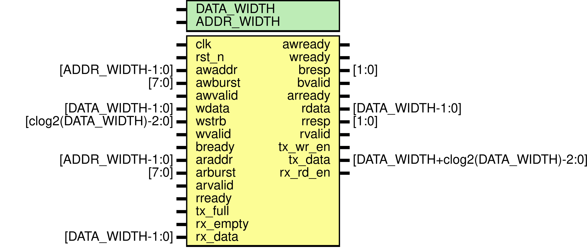
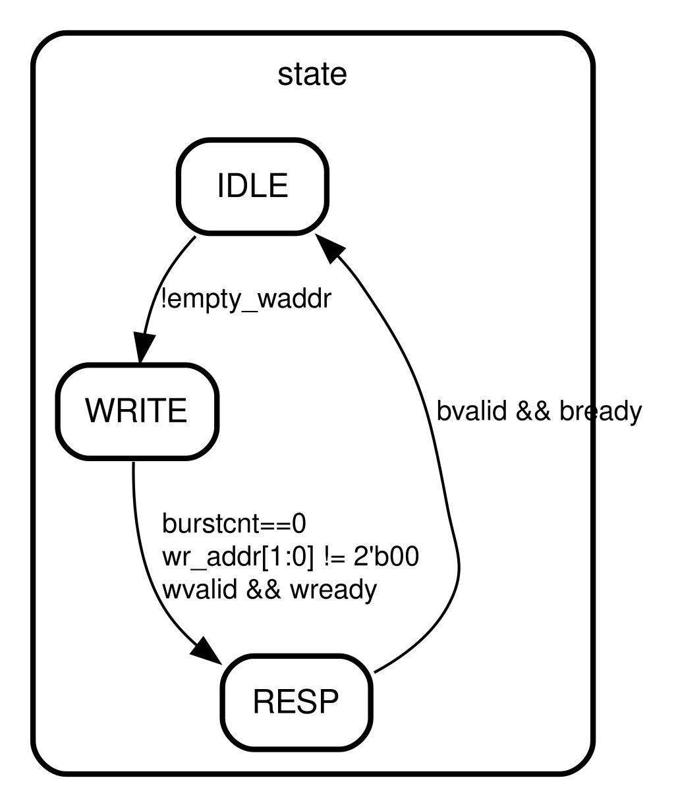
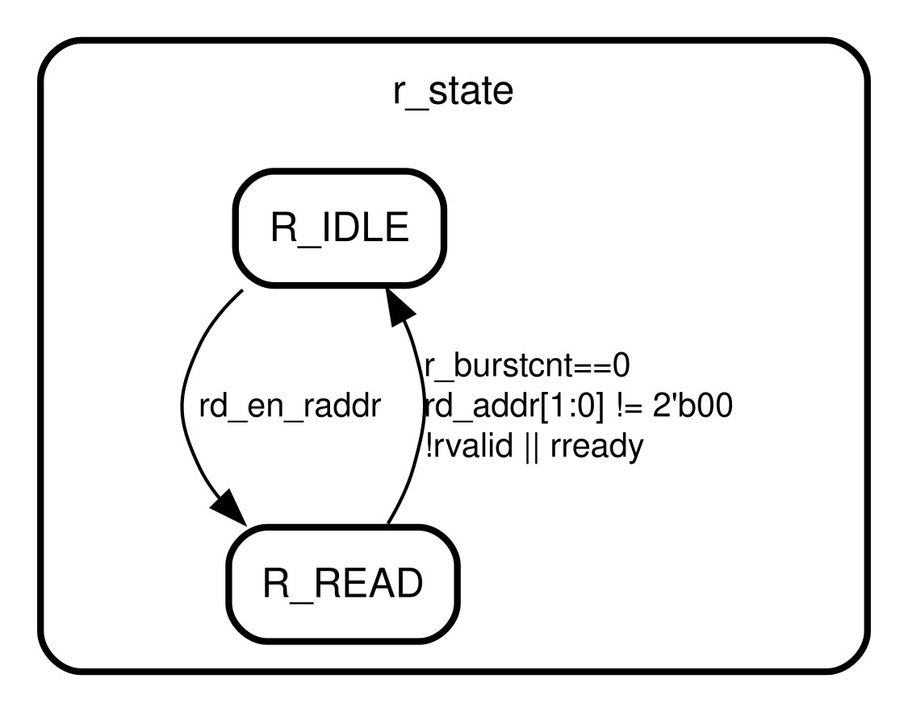
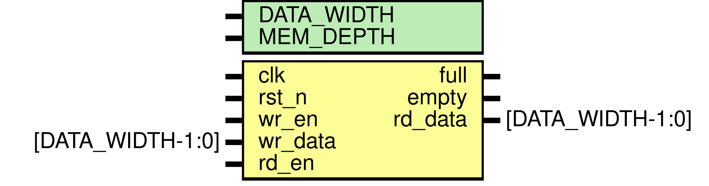
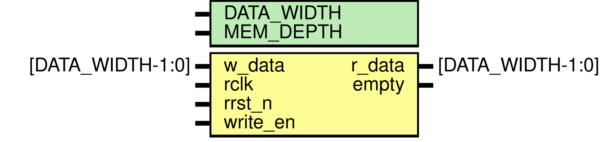

# AXI4 Slave with Control, Status, and FIFO Interfaces

A Verilog/SystemVerilog implementation of a custom AXI4-style slave peripheral. The design provides control and status registers, transmit and receive asynchronous FIFOs, AXI-style write/read channels, and clock-domain crossing support.


## Features

- Simplified AXI4-style write and read channels
- Ready/valid handshakes for address, data, and response channels
- 32-bit control register
- 32-bit status register
- Independent transmit and receive asynchronous FIFOs
- Separate TX and RX clocks
- Gray-code pointer synchronization for clock-domain crossing
- Write strobes for transmit data
- Burst address and length handling
- SLVERR responses for unaligned or unsupported accesses
- Verilator and QuestaSim testbench support
- Yosys synthesis outputs and Xilinx-focused netlists

## Register Map

| Address | Access | Size | Description |
|---|---:|---:|---|
| `0x00000000` | Read/Write | 32-bit | Control register |
| `0x00000004` | Read-only | 32-bit | Status register |
| `0x00000008` | Write | 32-bit | TX FIFO data |
| `0x0000000C` | Read | 32-bit | RX FIFO data |

### Status Register

| Bit | Description |
|---:|---|
| 0 | Reserved, currently always `0` |
| 1 | RX data available: `0` = empty, `1` = not empty |
| 2 | TX FIFO full indicator |
| 31:3 | Reserved |

## Architecture

```text
AXI Master
    |
    | AW/ W / B channels
    | AR / R channels
    v
+------------------------------+
|            top               |
|                              |
|    +------------------+      |
|    |      slave       |      |
|    | control/status   |      |
|    | write/read FSMs  |      |
|    +-------+----------+      |
|            |                 |
|     +------+--------+        |
|     |               |        |
| TX async FIFO  RX async FIFO |
+------------------------------+
```

The AXI write channel decodes address `0x00000000` for the control register and `0x00000008` for TX FIFO writes. Unsupported or misaligned accesses return `SLVERR`.

The AXI read channel decodes address `0x00000000` for the control register, `0x00000004` for status, and `0x0000000C` for RX FIFO reads.

The TX FIFO transfers data from the AXI clock domain to `tx_rclk`. The RX FIFO transfers peripheral data from `rx_wclk` into the AXI clock domain.

## Clock Domains

| Signal | Clock Domain | Purpose |
|---|---|---|
| `clk` | Main clock | AXI interface and slave logic |
| `tx_rclk` | TX read clock | Reads data from the transmit FIFO |
| `rx_wclk` | RX write clock | Writes peripheral data into the receive FIFO |

## Repository Structure

```text
axi4-slave/
├── rtl/
│   ├── top.v
│   ├── slave.v
│   ├── async_fifo.v
│   └── sync_fifo.v
├── tb/
│   ├── full_top_tb.sv
│   ├── tb_top.sv
│   ├── tb_slave.sv
│   ├── tb_sync_fifo.sv
│   └── tbAsyncFifo.sv
├── sim/
│   └── VCD waveform files
├── synth/
│   ├── gate-level/
│   │   ├── Yosys gate-level diagrams
│   │   └── Flattened module diagrams
│   └── xilinx/
│       ├── Xilinx-oriented synthesis diagrams
│       └── Generated DOT/PDF outputs
├── netlist/
│   ├── top.v
│   └── top_xilinx.v
├── docs/
│   ├── slave.jpg
│   ├── async_fifo.jpg
│   ├── sync_fifo.jpg
│   ├── fsm_slave_00.jpg
│   └── fsm_slave_11.jpg
├── verilator_script.sh
├── run.do
├── run_log.txt
└── README.md
```

## Diagrams

### Slave RTL Overview



### Slave Write FSM



### Slave Read FSM



### Synchronous FIFO



### Asynchronous FIFO



## Requirements

The following tools can be used depending on the workflow:

- [Verilator](https://www.veripool.org/verilator/) — linting and SystemVerilog simulation
- [Yosys](https://yosyshq.net/yosys/) — synthesis and gate-level netlist generation
- QuestaSim/ModelSim(optional) — coverage-enabled SystemVerilog simulation
- GTKWave or another VCD viewer — waveform inspection
- Graphviz — viewing or regenerating DOT diagrams
- GNU Make or Bash — optional automation

## Quick Start

Clone the repository:

```bash
git clone https://github.com/singhanshuman01/axi4-slave.git
cd axi4-slave
```

## Verilator Simulation

The included script builds the SystemVerilog testbench with Verilator:

```bash
chmod +x verilator_script.sh
./verilator_script.sh
```

The script compiles the RTL and testbench in binary/timing mode, enables tracing, suppresses selected non-fatal warnings, and places generated files under `vsim/`.

The exact command can also be run directly:

```bash
verilator --binary --timing --trace \
  -j 0 \
  -Wno-fatal \
  -Wno-lint \
  -Wno-style \
  -Wno-TIMESCALEMOD \
  -Wno-CONSTRAINTIGN \
  --top-module tb \
  -Mdir vsim \
  rtl/sync_fifo.v \
  rtl/async_fifo.v \
  rtl/slave.v \
  rtl/top.v \
  tb/full_top_tb.sv
```

After compilation, run the generated executable:

```bash
./vsim/Vtb
```

To select a test:

```bash
./vsim/Vtb +TEST=directed
./vsim/Vtb +TEST=random
./vsim/Vtb +TEST=fifo_backpressure
./vsim/Vtb +TEST=addr_test
```

Generated simulation traces can be viewed with a VCD-compatible waveform viewer.

## QuestaSim/ModelSim Simulation

Run the provided script from the repository directory:

```bash
vsim -do run.do
```

The script:

1. Creates or recreates the `work` library.
2. Compiles the RTL and `tb/full_tb_top.sv`.
3. Optimizes the testbench.
4. Runs simulation with coverage enabled.
5. Disables selected coverage points.
6. Saves coverage data to `cov_data4.ucdb`.
7. Exits after the simulation completes.

The default address test is selected by:

```text
+TEST=addr_test
```

The test selection can be changed in `run.do`:

```text
vsim -coverage tb_opt +TEST=random
```

Supported test names in `full_top_tb.sv` include:

- `directed`
- `random`
- `fifo_backpressure`
- `addr_test`

## Waveform Viewing

Simulation files are stored in `sim/` with the `.vcd` extension:

```text
sim/
├── async_fifo.vcd
├── sync_fifo.vcd
├── tb_slave.vcd
├── tb_top.vcd
└── waves.vcd
```

Open a VCD file in GTKWave:

```bash
gtkwave sim/waves.vcd
```

## Yosys Synthesis

A typical Yosys synthesis flow for the top-level module is:

```yosys
read_verilog rtl/sync_fifo.v
read_verilog rtl/async_fifo.v
read_verilog rtl/slave.v
read_verilog rtl/top.v
hierarchy -top top
proc
opt
fsm
opt
memory
opt
techmap
opt
write_verilog netlist/top.v
stat
```

To synthesize the individual slave module:

```yosys
read_verilog rtl/sync_fifo.v
read_verilog rtl/slave.v
hierarchy -top slave
proc
opt
fsm
opt
memory
opt
stat
show
```

Generated gate-level diagrams and PDF renders are available under:

```text
synth/gate-level/
synth/xilinx/
```

The files with `.dot` extensions can be displayed or converted using Graphviz:

```bash
dot -Tpdf synth/gate-level/top.dot -o synth/gate-level/top.pdf
dot -Tsvg synth/gate-level/top.dot -o top.svg
```

To inspect the Xilinx-oriented synthesis graph:

```bash
dot -Tpdf synth/xilinx/top.dot -o synth/xilinx/top.pdf
dot -Tpdf synth/xilinx/slave.dot -o synth/xilinx/slave.pdf
```

## Netlist Files

The repository includes generated Verilog representations:

```text
netlist/top.v
netlist/top_xilinx.v
```

These netlists are synthesis outputs or synthesis-oriented representations and are not recommended as the primary source for RTL modifications. Make changes in `rtl/` and regenerate the netlist.

## RTL Verification Notes

The testbench environment includes:

- AXI transaction generation
- Address and write-data driving
- Read-data monitoring
- TX and RX FIFO agents
- Scoreboard-based checking
- Directed tests
- Randomized transactions
- FIFO backpressure testing
- Address-FIFO stress testing
- Timeout detection
- VCD tracing

Example areas covered by the testbench include:

- Control register writes and reads
- Status register reads
- TX FIFO writes
- RX FIFO reads
- Misaligned accesses
- Unsupported address responses
- Burst transactions
- TX FIFO overflow/backpressure
- RX FIFO filling
- Asynchronous clock-domain behavior
- Address FIFO stress
- AXI response channel behavior

## Linting

Verilator can be used to perform RTL linting:

```bash
verilator --lint-only \
  -Wall \
  rtl/sync_fifo.v \
  rtl/async_fifo.v \
  rtl/slave.v \
  rtl/top.v
```

Warnings can be narrowed with suppression flags if the design contains intentional constructs:

```bash
verilator --lint-only \
  -Wall \
  -Wno-fatal \
  rtl/sync_fifo.v \
  rtl/async_fifo.v \
  rtl/slave.v \
  rtl/top.v
```

## AXI Interface Summary

### Write Address

- `awaddr`
- `awburst`
- `awvalid`
- `awready`

### Write Data

- `wdata`
- `wstrb`
- `wvalid`
- `wready`

### Write Response

- `bresp`
- `bvalid`
- `bready`

### Read Address

- `araddr`
- `arburst`
- `arvalid`
- `arready`

### Read Data

- `rdata`
- `rresp`
- `rvalid`
- `rready`

The write and read address channels store burst metadata in synchronous FIFOs before processing. The design uses `awburst` and `arburst` fields as burst-length metadata.

## Peripheral Interface Summary

### TX FIFO read interface

- `tx_rclk`
- `tx_empty`
- `tx_rd_en`
- `tx_rd_data`

### RX FIFO write interface

- `rx_wclk`
- `rx_full`
- `rx_wr_en`
- `rx_wr_data`

These two write/read channels can be used by peripherals like spi/i2c/uart etc.


## Limitations

This implementation is intended primarily for educational and prototype use. It is a custom AXI-style slave rather than a complete vendor-verified AXI4 IP block.

Current limitations include:

- Not a full AXI4 protocol implementation
- Custom register and address decoding
- Simplified burst handling
- Limited transfer-size support
- No AXI ID or cache fields
- No formal AXI interconnect validation
- Async FIFO implementation should be reviewed and stress-tested for timing and metastability constraints
- No timing constraints or FPGA constraints files
- No automated CI build configuration